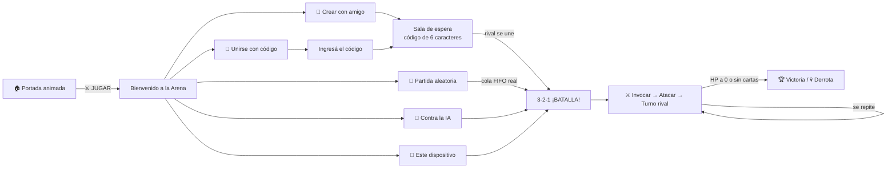
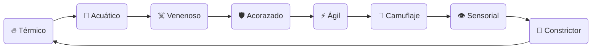
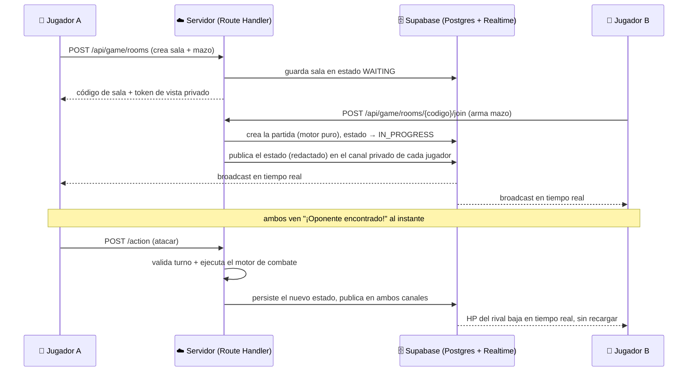

<div align="center">

# 🦎 REPTILES RPG
### Game Balance System & Arena de Combate en Tiempo Real

**Un videojuego de cartas por turnos con 40 reptiles reales, 8 afinidades tipo piedra-papel-tijera,
combate multijugador en vivo entre dispositivos distintos, IA con decisiones reales, y un motor
de balance profesional detrás de cada número.**

[](https://nextjs.org)
[](https://www.typescriptlang.org)
[](https://supabase.com)
[](https://tailwindcss.com)
[](#-tests)
[](https://vercel.com)

[🎮 Modos de juego](#-modos-de-juego) ·
[🐍 Afinidades](#-sistema-de-afinidades) ·
[⚔️ Motor de combate](#️-motor-de-combate) ·
[🌐 Multijugador en vivo](#-multijugador-en-tiempo-real) ·
[🛠️ Instalación](#️-puesta-en-marcha)

</div>

---

## 📖 Índice

1. [¿Qué es Reptiles RPG?](#-qué-es-reptiles-rpg)
2. [Un vistazo al ciclo de juego](#-un-vistazo-al-ciclo-de-juego)
3. [El roster: 40 reptiles reales](#-el-roster-40-reptiles-reales)
4. [Sistema de afinidades](#-sistema-de-afinidades)
5. [Motor de combate](#️-motor-de-combate)
6. [Modos de juego](#-modos-de-juego)
7. [Multijugador en tiempo real](#-multijugador-en-tiempo-real)
8. [Información oculta y seguridad del servidor](#-información-oculta-y-seguridad-del-servidor)
9. [Panel de administración](#-panel-de-administración)
10. [Herramientas de balance](#-herramientas-de-balance-para-el-diseñador)
11. [Arquitectura técnica](#️-arquitectura-técnica)
12. [Estructura de carpetas](#-estructura-de-carpetas)
13. [Puesta en marcha](#️-puesta-en-marcha)
14. [Variables de entorno](#-variables-de-entorno)
15. [Tests](#-tests)
16. [Despliegue en Vercel](#-despliegue-en-vercel)
17. [Stack tecnológico](#-stack-tecnológico)
18. [Roadmap](#-roadmap)

---

## 🎯 ¿Qué es Reptiles RPG?

**Reptiles RPG** es dos cosas en un mismo proyecto:

- 🎮 **Un juego de cartas por turnos** donde armás un mazo de hasta 5 reptiles reales y batallás explotando ventajas de afinidad — contra un amigo en otro dispositivo y otra red, contra la IA, contra un rival aleatorio emparejado en tiempo real, o cara a cara en el mismo celular.
- 📊 **Un laboratorio de diseño de juegos**: cada estadística, cada fórmula de daño y cada matchup entre los 40×40 reptiles posibles es auditado automáticamente para detectar personajes rotos, débiles o matemáticamente dominantes — antes de que lleguen a un jugador real.

Ambas mitades comparten **el mismo motor**: el daño que ves en una batalla online contra otro jugador es exactamente el mismo número que calcularía el simulador de diseño. No hay dos fuentes de verdad.

---

## 🌀 Un vistazo al ciclo de juego



---

## 🐊 El roster: 40 reptiles reales

Nada de criaturas inventadas: cada carta es una especie real (nombre científico incluido), con estadísticas derivadas de su biología y una fotografía real obtenida en vivo desde **Wikipedia, Wikimedia Commons, iNaturalist y GBIF** (con verificación taxonómica automática — nunca se muestra la foto equivocada por un nombre científico mal escrito).

| Estadística | Qué representa |
|---|---|
| ❤️ **HP** | Puntos de vida |
| ⚔️ **ATK** | Ataque |
| 🛡️ **DEF** | Defensa |
| ⚡ **SPD** | Velocidad |
| 👁️ **INST** | Instinto (precisión / iniciativa) |
| 🧬 **ADP** | Adaptabilidad |

Todo reptil respeta el mismo **BST (Base Stat Total) = 360**, así que ninguno es "objetivamente mejor" — cada uno es una combinación distinta de fortalezas y debilidades, auditada para que ningún arquetipo (tanque, glass cannon, velocista) domine el ranking estructuralmente.

---

## 🔺 Sistema de afinidades

8 afinidades organizadas en un **ciclo cerrado**, como piedra-papel-tijera pero con más matices:



Cada afinidad, siguiendo la flecha:

- 🟢 **Vence** a las 2 siguientes en el ciclo.
- 🔴 **Pierde** contra las 2 anteriores.
- ⚪ Es **neutral** con las 4 restantes (incluida ella misma).

Ese cierre matemático (2 ventajas / 2 desventajas / 4 neutrales, siempre) se **audita automáticamente** en `/afinidades` — si algún cambio de diseño rompe el ciclo, la herramienta lo marca al instante con 🚨.

---

## ⚔️ Motor de combate

Todas las fórmulas viven en un único lugar (`lib/game-engine/`), parametrizadas — nunca hay un número mágico escondido en un componente:

```
Daño = Potencia × (ATK + offset) / (DEF + offset) × MultiplicadorAfinidad × STAB ÷ divisor
```

- **STAB** (*Same Type Attack Bonus*): una habilidad hace más daño si su tipo coincide con la afinidad del reptil que la usa.
- **Súper efectivo**: multiplicador de afinidad favorable, con su propio destello visual en combate.
- **Índice Ofensivo / Defensivo / de Movilidad**: combinaciones ponderadas de estadísticas usadas para calcular *matchups* y detectar desbalances.
- **Probabilidad de victoria en un matchup** = poder de combate propio ÷ (poder propio + poder rival) — donde el poder de combate ya incorpora el multiplicador de afinidad, así que la matriz de 40×40 enfrentamientos posibles se puede auditar entera de un vistazo en `/matchups`.

Este es el **mismo código** que corre en:
- El simulador de diseño (`/simulador`), para un game designer probando cambios.
- El servidor, cuando dos jugadores reales pelean online — el motor corre en el backend, nunca en el navegador de nadie.
- La IA, para decidir qué habilidad usar.

---

## 🎮 Modos de juego

| Modo | Cómo funciona |
|---|---|
| 🤝 **Crear con amigo** | Armás tu mazo, generás un código de sala único y se lo compartís a tu rival. Pantalla de espera con el código, copiar-al-portapapeles y cancelar. |
| 🔑 **Unirse con código** | Tu rival ingresa el código, arma su mazo, y ambos entran a la batalla — sin importar en qué red o dispositivo esté cada uno. |
| 🎲 **Partida aleatoria** | Cola de emparejamiento real (no un timer simulado): el sistema te empareja con el primer rival disponible en cuanto ambos estén buscando. Si nadie aparece, te avisa. |
| 🤖 **Contra la IA** | La IA arma su propio mazo y **razona de verdad**: al invocar, elige la carta con mejor ventaja de afinidad contra tu reptil activo; al atacar, prioriza la habilidad de mayor daño esperado, o una jugada defensiva si su HP está bajo. |
| 📱 **Este dispositivo** | El clásico "pasa y juega": dos personas, un mismo celular o computadora, sin necesidad de conexión. |

Todos los modos comparten el mismo tablero, las mismas cartas y el mismo motor de daño — la única diferencia es **quién ejecuta las reglas** (el navegador en modo local, el servidor en modo online).

---

## 🌐 Multijugador en tiempo real

La parte más ambiciosa del proyecto: dos jugadores en **dispositivos físicos distintos, en redes distintas**, viendo la misma partida actualizarse en vivo — sin que ninguno tenga que recargar la página.



**¿Por qué no un servidor de sockets propio?** El proyecto vive en Vercel (funciones serverless, sin proceso Node persistente). En vez de inventar infraestructura nueva, se reutiliza **Supabase Realtime** (ya incluido en la librería cliente que el proyecto ya usaba) publicando eventos desde el servidor — cero dependencias nuevas, cero servidores adicionales que mantener.

- **Reconexión real**: si el WiFi se corta a mitad de partida, el cliente se re-suscribe y vuelve a pedir el estado actual — la partida sigue exactamente donde estaba, nunca se reinicia.
- **Autoridad del servidor**: todo daño, HP y decisión de turno se calcula y valida en el backend. El cliente nunca puede "inyectar" un HP falso — solo puede pedir una acción, que el servidor acepta o rechaza.

---

## 🕵️ Información oculta y seguridad del servidor

Un juego de cartas real necesita niebla de guerra: **nunca deberías poder ver el mazo sin jugar de tu rival**, ni siquiera espiando el tráfico de red del navegador.

- El servidor redacta el estado antes de emitirlo: el mazo no jugado del rival llega al navegador como una lista de `"?"` — mismo largo, cero información.
- Las cartas **ya jugadas** (activa en el campo, o en el cementerio) sí son públicas — es información legítima, la viste al ser jugada.
- Cada jugador escucha un canal privado con un token opaco e impredecible; sin conocer el token de tu rival, es imposible suscribirse a su vista.
- El turno se valida **en el servidor**, no en la pantalla: un intento de atacar fuera de tu turno se rechaza con un error explícito, sin importar lo que diga el cliente.

---

## 🔐 Panel de administración

Un botón discreto **ADMIN** en la portada abre un login (misma sesión firmada por HMAC que protege todo `/admin`) para:

- **Reptiles**: crear, editar estadísticas con auditoría de balance en vivo, desactivar (soft-delete) o eliminar.
- **Habilidades**: editar potencia, precisión y efecto de cualquiera de las 160 habilidades.

Todo cambio persiste en Postgres al instante y el resto de la app (roster, ranking, dashboard, mazos disponibles) se actualiza sin necesitar un redeploy.

---

## 📊 Herramientas de balance (para el diseñador)

Además del juego en sí, el proyecto incluye un panel completo de **game design tooling**:

- **Dashboard**: salud general del roster y del metajuego en tiempo real.
- **Comparador**: dos reptiles lado a lado, stat por stat.
- **Simulador de daño**: probá cualquier ataque contra cualquier objetivo con cualquier configuración de motor.
- **Matchups**: la matriz completa de 40×40 enfrentamientos, con probabilidad de victoria.
- **Ranking**: quién domina y quién queda atrás, según el índice de poder de combate.
- **Auditoría**: detecta automáticamente BST fuera de estándar, estadísticas extremas y win rates fuera de rango (`REVISAR` / `RIESGO_ALTO`).
- **Familias / Afinidades / Habilidades**: exploración y edición del contenido base.
- **Configuración**: ajustá cualquier multiplicador del motor desde la interfaz, sin tocar código.

---

## 🏗️ Arquitectura técnica

- **Next.js 16 (App Router, Turbopack) + React 19 + TypeScript estricto.**
- **Route groups** separan dos experiencias con el mismo dominio: `(landing)` (portada + `/jugar/*`, sin sidebar) y `(tool)` (dashboard, roster, admin y el resto de las herramientas, con sidebar) — mismas URLs de siempre, cero rutas rotas.
- **Supabase Postgres** como única fuente de verdad para reptiles, habilidades, configuración del motor y partidas (salas, jugadores, movimientos, cola de emparejamiento).
- **Supabase Realtime (Broadcast)** para la sincronización en vivo del multijugador — sin sockets propios, sin servidor adicional.
- **Motor de cartas puro** (`lib/card-game/engine.ts`): un *reducer* `(state, acción) => state` sin efectos secundarios, que corre tanto en el cliente (modo local/IA) como en el servidor (modo online) sin cambiar una sola línea — eso es lo que le da autoridad al servidor sin duplicar lógica de juego.
- **IA heurística real** (`lib/card-game/ai.ts`): sin aleatoriedad disfrazada de inteligencia — reutiliza el mismo cálculo de daño y de afinidades que ve un jugador humano en pantalla.
- **Zustand** para el estado de partida local, **Framer Motion** para toda animación de combate, **Tailwind CSS v4** para estilos.

---

## 📁 Estructura de carpetas

```
src/
  app/
    (landing)/              # Portada animada + todo /jugar (sin sidebar)
      page.tsx              # Hero animado, botón JUGAR
      layout.tsx            # Header discreto + modal de login admin
      jugar/
        page.tsx            # "Bienvenido a la Arena" — selector de modo
        crear/, unirse/, aleatorio/, ia/, local/   # un flujo por modalidad
        sala/[codigo]/       # Tablero de batalla online en vivo
        mesa/                 # Tablero de batalla local / vs IA
    (tool)/                 # Todas las herramientas de diseño (con sidebar)
      dashboard/, roster/, comparador/, simulador/, matchups/, ranking/,
      afinidades/, habilidades/, auditoria/, nuevo-personaje/, familias/,
      configuracion/, admin/, reptiles/[id]/
    api/
      admin/                # Login/logout/me + CRUD (service_role)
      game/                 # rooms, join, action, cancel, queue — autoridad del servidor
  components/
    cards/                  # GameCard (con degradación visual por HP), Board, TurnBanner,
                            # AttackAnimation, Countdown, ConnectionBanner, DeckBuilder
    admin/                  # AdminGate, AdminLoginModal, ReptileEditorForm
    layout/                 # Sidebar, AppShell, RosterProvider, GlobalSearch (Ctrl+K)
  lib/
    game-engine/            # ÚNICA fuente de verdad de toda fórmula de balance
    card-game/              # engine.ts (reducer puro) + ai.ts (heurística de la IA)
    supabase/               # client/server/admin, queries, game-queries, realtime
    store/                  # game-store (partida local), roster-store, config-store
    hooks/                  # useRoster, useEngineData, useGameRoom, useAdminAuth
  data/                     # Roster y habilidades semilla (para scripts/seed.ts y tests)
supabase/migrations/        # Esquema SQL versionado (roster, salas online, RLS, grants)
scripts/                    # seed.ts, check-taxonomy.ts, fix-grants.sql
```

---

## 🛠️ Puesta en marcha

```bash
git clone TU_REPOSITORIO
cd reptiles-rpg
npm install
cp .env.example .env.local   # completá las variables (ver abajo)
npm run dev
```

Abrí [http://localhost:3000](http://localhost:3000) — te recibe la portada animada.

### Base de datos (Supabase)

1. Creá un proyecto en [supabase.com](https://supabase.com) (gratis).
2. En el **SQL Editor**, ejecutá en orden todo `supabase/migrations/*.sql` (esquema base, salas de juego, multijugador online, y el ajuste de nulabilidad de `estado`).
3. Completá en `.env.local` las claves de `Project Settings → API Keys`.
4. Sembrá los 40 reptiles + 160 habilidades:
   ```bash
   npx tsx scripts/seed.ts
   ```
5. Elegí una contraseña para el panel `/admin` en `ADMIN_PASSWORD`.

> Si ves `permission denied for table ...`, falta el `GRANT` base del rol (RLS solo no alcanza) — corré `scripts/fix-grants.sql` en el SQL Editor.

---

## 🔑 Variables de entorno

| Variable | Para qué |
|---|---|
| `NEXT_PUBLIC_SUPABASE_URL` | URL del proyecto Supabase |
| `NEXT_PUBLIC_SUPABASE_PUBLISHABLE_KEY` | Clave pública (navegador) |
| `SUPABASE_SECRET_KEY` | Clave `service_role` — **solo servidor**, nunca en el navegador. Necesaria para `/admin`, el seed y toda la autoridad del servidor en `/api/game/*` |
| `ADMIN_PASSWORD` | Contraseña del panel de administración |
| `NEXT_PUBLIC_WIKIPEDIA_API_URL` / `..._WIKIMEDIA_...` / `..._INATURALIST_...` / `..._GBIF_...` | Endpoints públicos de imágenes y taxonomía — configurables sin tocar código |

---

## ✅ Tests

```bash
npm run test
```

33 tests (Vitest) que validan, sin necesitar red ni Supabase:

- Cierre matemático de la matriz de afinidades (2 ventajas / 2 desventajas / 4 neutrales, siempre).
- BST = 360 en todo el roster.
- Matchup en espejo = 50/50 exacto.
- Detección de personajes dominantes o débiles.
- El motor de cartas: invocación, combate, condiciones de victoria — y que el daño de un ataque coincide **exactamente** con el motor de balance del simulador.
- La IA nunca elige una acción ilegal, y prioriza daño esperado / matchup favorable de forma verificable.
- El estado "derrotado" del multijugador online se calcula correctamente incluso cuando el motor ya limpió al reptil del tablero.

---

## 🚀 Despliegue en Vercel

`npm run build` está verificado (TypeScript estricto sin errores, ESLint sin errores). Conectá el repositorio en Vercel y agregá las mismas variables de `.env.local` en la configuración del proyecto — sin ellas el sitio no puede leer el roster ni levantar una sala de juego.

---

## 🧰 Stack tecnológico

Next.js 16 (App Router, Turbopack) · React 19 · TypeScript · Tailwind CSS v4 · Supabase (Postgres + Realtime) · Zustand · Framer Motion · Recharts · TanStack Table · React Hook Form + Zod · Lucide React · cmdk (Ctrl+K) · Vitest.

---

## 🗺️ Roadmap

- [ ] Ranking global de jugadores online (histórico de partidas)
- [ ] Torneos con eliminación directa
- [ ] Más de 5 cartas por mazo con límite de costo (deckbuilding avanzado)
- [ ] Reemisión/replay de partidas terminadas
- [ ] Skins alternativos de tablero

---

<div align="center">

Hecho con 🦎, TypeScript y demasiado café.

</div>
